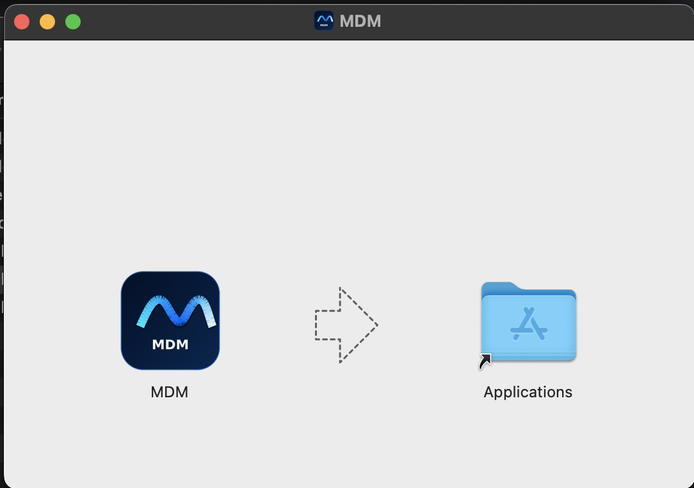
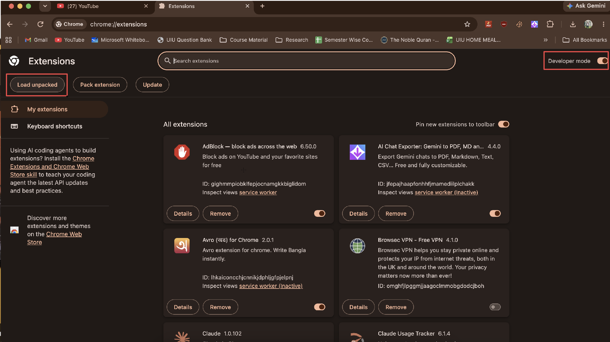
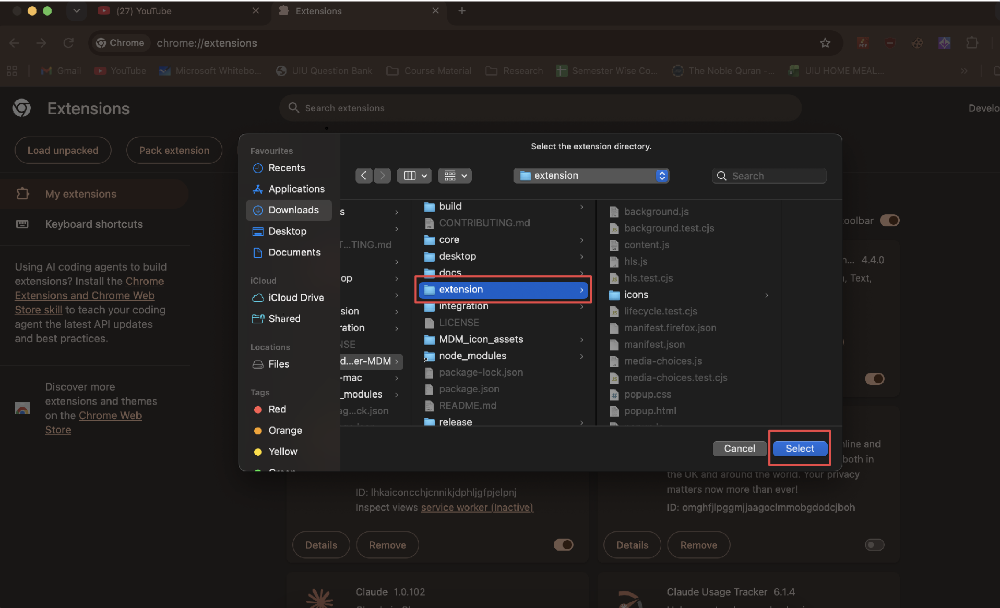
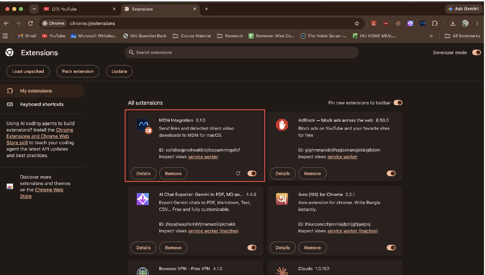
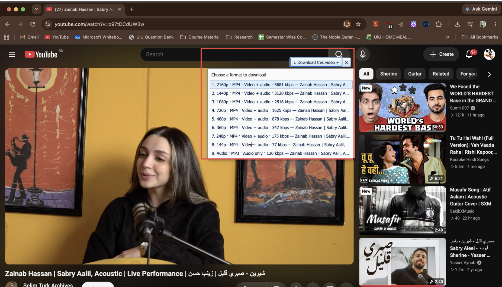
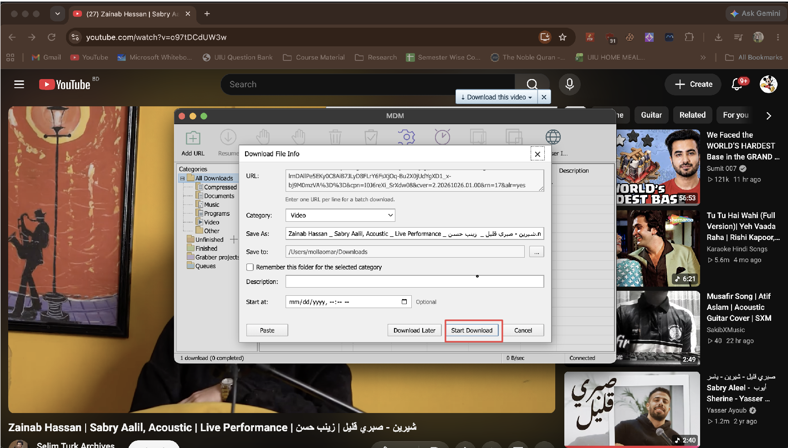
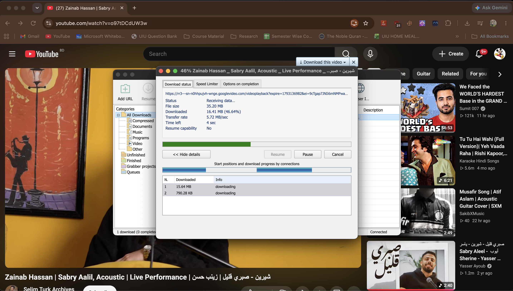

# MDM (Mac Download Manager)

A fast, lightweight, and modern download manager for macOS featuring multi-connection segmented transfers, pause & resume support, and seamless browser video capture.

Built for **macOS Ventura (13.0+) and later**, fully optimized for both **Apple Silicon (M1/M2/M3/M4/M5)** and **Intel (x86_64)** Mac systems.

---

## ✨ Features

- **⚡ Multi-Segment Transfers:** Splits large downloads into multiple concurrent connections to maximize download throughput.
- **⏯️ Pause & Resume Support:** Safe pause and resume with HTTP Range requests (`Accept-Ranges` and `ETag`/`Last-Modified` validation).
- **📹 Video & Stream Capture:** High-definition YouTube and HLS (`.m3u8`) video stream detection with automatic FFmpeg audio/video muxing.
- **🌐 Browser Extensions:** Deep integration with Google Chrome, Microsoft Edge, Brave, and Apple Safari.
- **⏱️ Download Scheduler:** Schedule transfers to start or stop automatically at specific dates and times.
- **🚀 Speed Limiter:** Set global or per-download bandwidth limits to prevent network saturation.
- **🗂️ Categories & Organization:** Automatic sorting into Video, Audio, Compressed, Documents, Programs, and custom categories.

---

## 📥 Step-by-Step Installation Guide

### Step 1: Download & Install MDM

1. Go to the [Releases](https://github.com/mollaomar991/Mac_download_Manager-MDM/releases) page.
2. Download the appropriate DMG package for your Mac architecture:
   - **Apple Silicon (M1, M2, M3, M4, M5):** `MDM-0.1.0-macOS-arm64.dmg`
   - **Intel Mac:** `MDM-0.1.0-macOS-x64.dmg`
3. Double-click the downloaded `.dmg` file to mount it.
4. Drag the **MDM** application icon into your **Applications** folder:

<p align="center">
  
</p>

---

### 🛡️ First-Time Launch on macOS (Gatekeeper Notice)

Because MDM is an open-source project without a paid Apple Developer ID certificate ($99/yr), macOS Gatekeeper may display a prompt when opening the app for the first time:  
`"MDM is damaged and can't be opened. You should move it to the Trash"` or `"unidentified developer"`.

This is standard macOS security quarantine for internet downloads. **The app is not damaged.** You can bypass this in one second:

#### Option A: Quick Terminal Command (Recommended)
Open your **Terminal** app, paste the following command, and press **Enter**:
```bash
xattr -cr /Applications/MDM.app
```
*This clears the browser quarantine attribute, allowing MDM to launch immediately.*

#### Option B: Via System Settings
1. Click **Cancel** on the alert dialog.
2. Open **System Settings** ( Apple menu → System Settings) → **Privacy & Security**.
3. Scroll down to the **Security** section.
4. Click **Open Anyway** next to the *"MDM was blocked"* notice, and enter your Mac password.

---

## 🧩 Browser Extension Setup

Integrate MDM with your favorite browser (Google Chrome, Microsoft Edge, Brave, etc.) to capture links and stream downloads automatically.

### Step 2: Enable Developer Mode in Your Browser
1. In your browser address bar, navigate to:
   - **Chrome / Brave:** `chrome://extensions`
   - **Microsoft Edge:** `edge://extensions`
2. Turn **ON** the **Developer mode** toggle in the top-right corner.
3. Click the **Load unpacked** button in the top-left corner:

<p align="center">
  
</p>

---

### Step 3: Select the Extension Folder
1. In the file selection window, navigate to your MDM project directory.
2. Select the **`extension`** folder and click **Select**:

<p align="center">
  
</p>

---

### Step 4: Extension Activated
The **MDM Integration** extension is now installed and active:

<p align="center">
  
</p>

> **Tip:** Open MDM on your Mac, click **Browser Integration** in the toolbar, and click **Refresh browsers** to register the native messaging connector.

---

## 🎬 How to Download Videos (YouTube & Web Media)

### Step 5: Detect Available Video Formats
1. Open any YouTube video or supported web stream.
2. **Play the video for 2–3 seconds** so the browser captures the stream data.
3. Click the floating **`↓ Download this video ▾`** button in the top-right corner of the video player.
4. Select your preferred resolution (e.g. 2160p, 1440p, 1080p, 720p, or Audio MP3):

<p align="center">
  
</p>

---

### Step 6: Confirm Download Details
MDM will instantly capture the media stream and open the **Download File Info** dialog:
- Customize the file name and destination folder if needed.
- Click **Start Download** (or choose **Download Later** to add it to your queue):

<p align="center">
  
</p>

---

### Step 7: Fast Multi-Segment Transfer
MDM downloads the video in high-speed parallel segments with real-time transfer stats and automatic audio-video muxing:

<p align="center">
  
</p>

---

## 🛠️ Building from Source

### Prerequisites
- macOS 13.0+ (Ventura or newer)
- Node.js v20 or v22
- npm

### Development Setup
```bash
# Clone the repository
git clone https://github.com/mollaomar991/Mac_download_Manager-MDM.git
cd Mac_download_Manager-MDM

# Install dependencies
npm ci

# Run automated tests
npm test

# Start the desktop application
npm start
```

### Build DMG Packages
```bash
# Build DMG for Apple Silicon (arm64: M1/M2/M3/M4/M5)
npx electron-builder --mac dmg --arm64 --publish never

# Build DMG for Intel (x86_64)
npx electron-builder --mac dmg --x64 --publish never
```
Output files will be generated in the `release/` directory.

---

## 📄 License

This project is licensed under the MIT License - see the [LICENSE](LICENSE) file for details.
